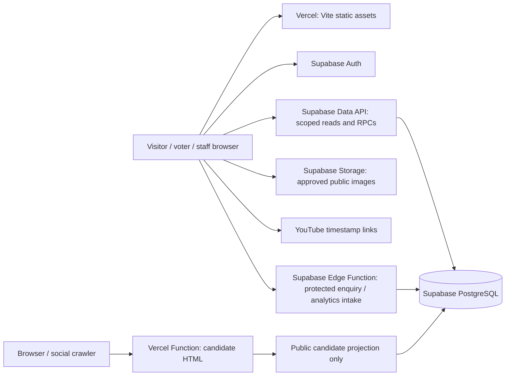

# Architecture

Proposed design only; no services or application code exist in Phase 0. See [requirements](REQUIREMENTS.md) for authoritative behavior and [database design](DATABASE_DESIGN.md) for transaction details.

## System boundary

Use a multipage/static shell and small ES modules for navigation, forms, data access, authentication, and role-specific screens. Vite builds assets; it is not a trusted application server. Add only the Supabase JavaScript client initially. Add a small QR library only when the QR stage needs it and after reviewing its footprint; QR codes encode canonical public URLs, never credentials.

## Frontend responsibilities

Render accessible pages and approved content, manage session UX, format dates, open YouTube links, show authorized statistics and vote receipts, and provide admin forms. Disable/reconfirm controls to improve usability, but treat every request as attacker-controlled. Avoid rendering stored raw HTML; use plain text/structured blocks and escaped attributes. Restrict video identifiers and URLs, image formats/sizes, and external link targets. Use a content security policy and safe session handling; browser-held tokens make XSS prevention critical.

## Supabase responsibilities and access paths

Auth owns credentials, verified phones, sessions, and token verification. PostgreSQL owns roles, content state, ledger integrity, visibility decisions, aggregation, and audits. Storage owns media under bucket/object policies; the database records approved media metadata. Edge Functions handle narrow public intake needing abuse controls or secrets, not the voting transaction itself.

| Caller | Allowed path | Data boundary |
| --- | --- | --- |
| Visitor | Allowlisted public read RPCs/projections | Published content, permitted statistics, selected published result version only |
| Voter | Public reads + own-state RPC + `cast_vote` RPC | Session-derived identity; only own receipts/allowance |
| Admin | Staff read/mutation RPCs | Current active role required; no raw voter ledger or confidential audit |
| Super Admin | Additional role, review/apply-adjustment, audit RPCs | Current protected role required for every call |
| Public intake function | Narrow insert-only enquiry/aggregate RPCs | Validation, rate limits, no generic database write gateway |

Keep base tables in a non-exposed application schema, with RLS enabled and no browser DML grants. Expose only reviewed functions in the API schema, revoke default `PUBLIC` execution, and grant functions to `anon`/`authenticated` selectively. Public functions explicitly filter publication and return approved columns. RLS filters rows, not individual result columns: totals and ranks require shaped responses, never `SELECT *` from a public aggregate view. Do not expose totals in realtime subscriptions, raw ledgers, HTML metadata, or default candidate sorting. Use neutral ordering when rank visibility is disabled.

Backend visibility rules: public numeric totals require `show_vote_totals`; during active voting, numeric responses/updates additionally require `show_live_counts`. Reject `show_live_counts = true` when `show_vote_totals = false`. Rankings require `show_rankings` independently and may be returned without numeric totals. After closure but before publication, return no public results, including totals, rankings, winner/tie labels, or the no-votes outcome. After publication, expose winner/tie labels or "No votes received"; snapshot totals and rankings continue to require their respective flags, while the live-count flag no longer applies. Shape every authorized response accordingly, including metadata and exports, and prohibit hidden-value ordering or hidden fields in public APIs. Frontend hiding is not an authorization control.

Prefer `SECURITY INVOKER` where sufficient; narrow `SECURITY DEFINER` functions may access private tables using a dedicated non-login owner with minimal grants. Set an empty/fixed safe `search_path`, fully qualify objects, check identity and current role explicitly, avoid dynamic SQL, and deny direct execution of helpers. Their privileged access requires explicit authorization even with RLS enabled. [Supabase RLS guidance](https://supabase.com/docs/guides/database/postgres/row-level-security) and [database function guidance](https://supabase.com/docs/guides/database/functions) explain these security boundaries.

## Authentication and role escalation prevention

Voters use Supabase SMS OTP sign-in with normalized E.164 +91 numbers. Each vote checks the trusted Auth user record has a confirmed current phone and that the validated session's authentication method includes SMS OTP. An email/password session with an attached phone alone is insufficient. Do not trust a submitted phone, `user_metadata`, UI state, or caller-supplied JWT text. Confirm the exact trusted AMR claim shape in implementation tests; issue or verify SMS sessions through Auth, never through a client assertion.

Phone edits must use Auth's verified phone-change flow. Proposed prototype policy disables application account deletion/recreation and phone-number changes during an active competition; any exception needs operator review. Document and test the eventual recovery/deletion process to avoid issuing a fresh voting identity. This is not a one-person guarantee.

Admins use email/password and protected `staff_roles` records checked on each privileged database call so demotion takes effect without waiting for role claims to expire. No public staff self-signup or self-editable role field. An operator bootstraps the first Super Admin through a controlled database operation with an audit record. Only an active Super Admin may invite/promote/demote staff; protect the last active Super Admin from removal and audit every change. Account provisioning may require a dedicated Edge Function using server-only Auth Admin credentials after validating the caller and checking their live role. Never let callers choose the acting administrator ID. Require MFA for real-school staff use; plan reauthentication for sensitive operations.

## Secure voting and results

`cast_vote(competition_id, candidate_id)` derives the voter ID, acquires a shared competition lock, locks a voter/competition guard row, then checks current time/state/eligibility/usage and inserts once. Competing voters share the competition lock; only the same voter's allowance is serialized. Administrative changes take an exclusive competition lock. See the precise lock order and duplicate handling in [DATABASE_DESIGN.md](DATABASE_DESIGN.md).

Do not put the service role in a voting proxy or browser. The publishable/anon key identifies the project, not a privileged user. Client-supplied totals and counters have no authority. Public total/rank queries calculate official ledger-derived data subject to the visibility rules above. Publication snapshots the authoritative totals: the highest positive total determines the winner or tied winners; all-zero eligible totals produce "No votes received" with no winner; no eligible candidates means publication is rejected. Cache counts only as replaceable derived data, never as the original ledger.

Only Super Admins may initiate, review, and apply vote adjustments. One Super Admin may perform all three operations in the prototype; each operation commits a protected, durable audit record atomically with its state change. Preserve the append-only adjustment ledger and immutable original votes. Adjustments never affect remaining voter allowance or modify published snapshots; changing public results requires an explicit republication operation. Reevaluate independent approval before a real-school deployment.

## Media and social previews on static hosting

Candidate canonical route: `/competitions/{competition-slug}/candidates/{candidate-slug}` with immutable slugs after publication. A Vercel rewrite sends this route to a small vanilla JavaScript Function, which retrieves only the public candidate projection using the publishable key. It returns complete escaped HTML containing title, description, canonical URL, `og:title`, `og:description`, `og:url`, `og:image`, and matching social-card metadata, plus a useful candidate summary and Vite assets for browser enhancement. No framework or full server-rendered application is needed.

This server response is essential: client-only changes to head tags are unreliable for crawlers that do not execute JavaScript. Route the function before any static fallback; missing/unpublished candidates return a real 404 without draft metadata. Load assets using the Vite manifest. Generate absolute HTTPS URLs from configured canonical origin, not untrusted Host headers. Social HTML never includes private counts or voter data. Start with `no-store` responses; avoid stale publication/visibility leaks through CDN caches. External social services may cache previews independently, so removal is not guaranteed and recrawl can be delayed.

Use private staging Storage for uploads and a separate public bucket only for explicitly approved derivative images. Public objects and social preview images are internet-readable; RLS cannot make an already-public URL confidential. Restrict upload/delete to authorized staff, validate content type and actual file signatures, reject active SVG/HTML, cap dimensions/bytes, strip EXIF, and record alt text and permission status. Private originals use expiring authorized URLs and never appear in public social tags. Removing content requires removing public derivatives and considering external caches. Avoid private student information in filenames/metadata.

Store YouTube video ID and integer start seconds and construct allowlisted `https://www.youtube.com/watch?v=...&t=...s` links. Do not host performance video files or load tracking embeds automatically. QR downloads point to the same candidate URL; no separate tracking identity is needed.

## Enquiries and aggregate analytics

Public Edge Function intake validates field lengths/types, allowed origins, rate limits, and an abuse challenge when necessary; CORS alone is not abuse protection. Enquiries go to private tables, never public reads. Aggregate event intake accepts only bounded event names and published entity IDs and increments daily buckets; it must not accept SQL or arbitrary dimensions. Do not persist IPs, device IDs, phone numbers, enquiry text, or cross-site identifiers in analytics. Network infrastructure may retain IPs in operational logs; review provider settings and retention. Voting conversion counts should come from accepted server transactions, not spoofable browser events. Browser visit/click metrics are approximate and bot-influenced.

## Deployment and practical limits

Future deployment builds Vite output to `dist`, with framework-free candidate Functions and explicit routes/security headers. Use separate development/production Supabase projects, restricted Auth redirect URLs, isolated preview environments, versioned migrations, and separately configured server secrets. A preview must never mutate production voting data. No deployment or cloud setup is authorized by this Phase 0 deliverable.

- Vercel Hobby is restricted to personal, non-commercial use and has resource limits. Reassess eligibility and capacity before any school-operated pilot; Hobby is not an assumed production plan. See [Hobby terms/limits](https://vercel.com/docs/plans/hobby) and [platform limits](https://vercel.com/docs/limits).
- Supabase Free has bounded database, Storage, egress, Auth, and compute capacity, and free projects can pause after low activity. Budget for storage/egress, OTP traffic, and restoration availability; do not promise uninterrupted event service. Confirm exact allowances in the account before a demo. See [billing quotas](https://supabase.com/docs/guides/platform/billing-on-supabase) and [free-project pausing](https://supabase.com/docs/guides/platform/free-project-pausing).
- SMS sign-in requires a supported SMS provider and can incur separate costs. Indian delivery may require provider-specific sender/template/DLT setup. Trial destination restrictions, cooldowns, OTP expiry, CAPTCHA, and Auth/provider rate limits make bulk real-phone testing impractical. Use isolated configured test numbers/codes for most tests, remove test bypasses before real use, and perform a small authorized real-delivery test. See [phone sign-in](https://supabase.com/docs/guides/auth/phone-login) and [Auth rate limits](https://supabase.com/docs/guides/auth/rate-limits).

Provider documentation checked for Phase 0 on 27 October 2026; terms/quotas remain external configuration to recheck at deployment. Exact quotas are deliberately not architectural constants.

## Tradeoffs

Direct Supabase RPCs keep the trusted stack small but require rigorous SQL permission and concurrency tests. The candidate Function adds a small server component to support crawler metadata. Polling authorized aggregates is simpler than realtime but introduces update latency; choose interval after load tests. Shared competition locks permit concurrent voters but administrative operations can briefly wait. Append-only audit tables resist application tampering, not a database owner; future production needs restricted operator access and off-platform audit retention. Phone authentication adds cost and friction and cannot prevent all coordinated voting abuse.
